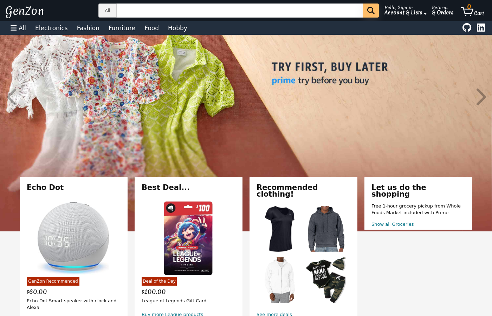
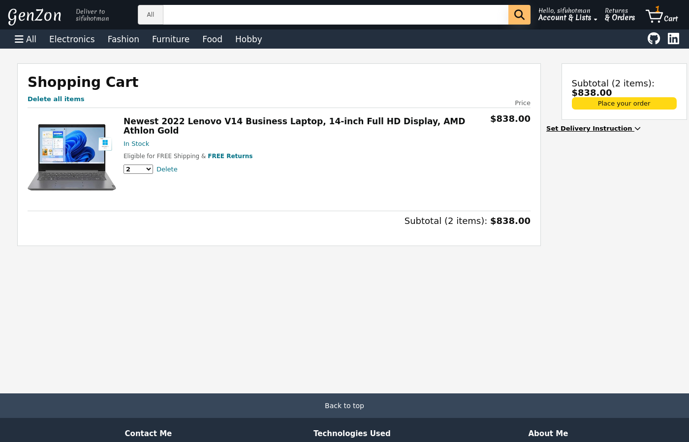
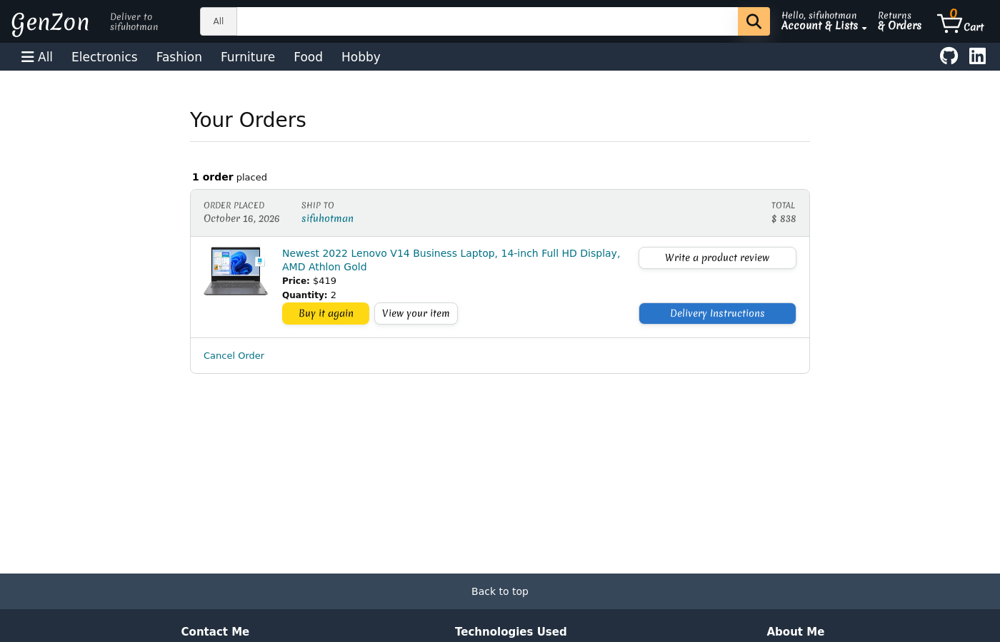

# GenZon

A full-stack e-commerce marketplace, modeled on Amazon, where users can list products for sale, shop by category, manage a cart, check out, and review what they bought.

**Live demo:** https://genzon.onrender.com. Click **Demo User** on the sign-in page to log in instantly.



## Features

- **Accounts:** sign up, log in, or try the app as the demo user
- **Browse and search:** live search bar, 5 categories, and sorting by price, rating, or date
- **Sell:** list a product with a name, price, stock, category, and image; edit or remove your listings
- **Cart:** add items, change quantities (limited to available stock), or clear the cart
- **Checkout and orders:** place orders, add delivery instructions, cancel or return, and buy again
- **Reviews:** 1–5 star ratings with written reviews that you can edit or delete

## Tech stack

| Layer | Technologies |
|---|---|
| Frontend | React, Redux (thunks), React Router, CSS |
| Backend | Python, Flask, SQLAlchemy, Alembic migrations, WTForms, Flask-Login |
| Database | PostgreSQL (hosted on Neon) |
| Deployment | Docker (multi-stage build), Render, Blueprint infrastructure-as-code |

## Engineering highlights

GenZon was first built in 2022 and revisited in 2026 to harden it for a public deployment:

- **Server-side authorization:** every write endpoint requires a login and checks ownership, so users can only change their own products, reviews, orders, and cart. Cart and order data are scoped to the signed-in user.
- **Prices you can't tamper with:** order totals are calculated on the server from database prices, never taken from the client.
- **Validation on the server:** price, quantity, stock, rating, and image checks run on the backend, not just in the browser, and errors come back as clean JSON (401/403/404) instead of server crashes.
- **Reproducible deploys:** a multi-stage Dockerfile builds the React app and the Flask API into one image. On startup it runs database migrations and seeds an empty database, so a fresh deploy comes up with demo data and no manual steps.
- **Verified end to end:** tested in a headless browser against the live site (login, cart, checkout, orders, sorting).

## Screenshots

### Shopping cart
Change quantities, remove items, and check out.



### Orders
Review past orders, update delivery instructions, cancel or return, or buy again.



## Running locally

1. Clone the repo:
   ```bash
   git clone https://github.com/yavuzabasiyanik/GenZon.git
   cd GenZon
   ```
2. Install the backend dependencies:
   ```bash
   pipenv install --dev -r dev-requirements.txt && pipenv install -r requirements.txt
   ```
3. Create a PostgreSQL user and database, then copy `.env.example` to `.env` and fill in `DATABASE_URL` and `SECRET_KEY`.
4. Migrate and seed the database, then start the API on port 5000:
   ```bash
   pipenv shell
   flask db upgrade
   flask seed all
   flask run
   ```
5. In a second terminal, start the frontend. It proxies API calls to port 5000 and opens http://localhost:3000:
   ```bash
   cd react-app
   npm install
   npm start
   ```

Or run the production build with Docker:
```bash
docker build -t genzon .
docker run -p 8000:8000 -e DATABASE_URL=<your postgres url> -e SECRET_KEY=<any secret> genzon
```

> The live demo runs on a free tier and stays warm with an uptime monitor. If it was idle, the first load can take up to a minute.
